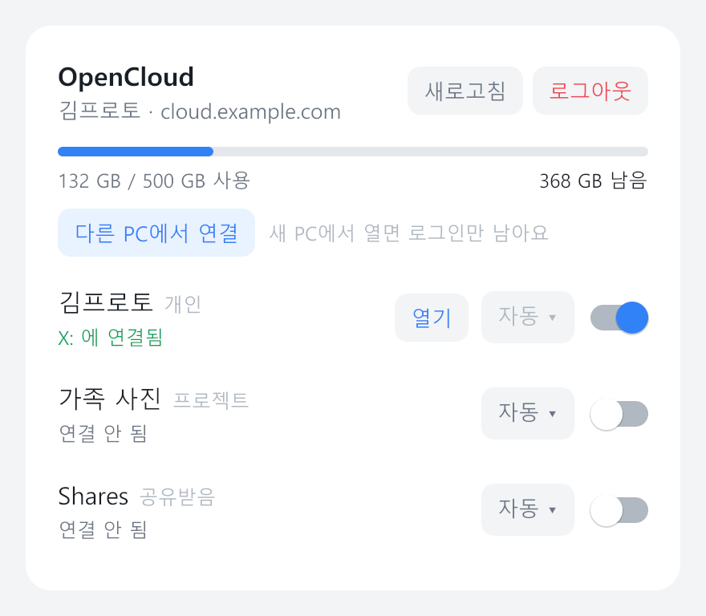
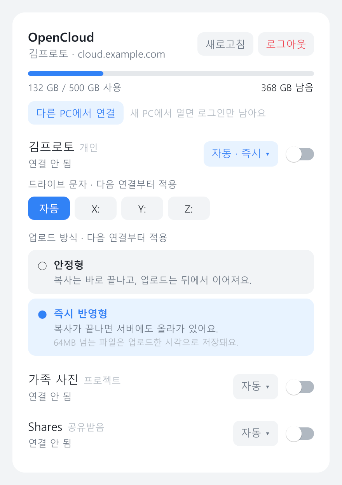
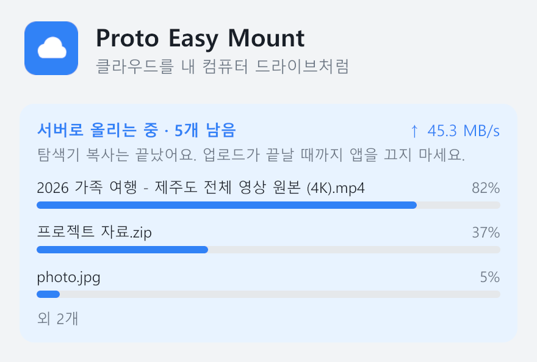

<div align="center">

# Proto Easy Mount

**클라우드 저장소를 내 PC의 드라이브처럼 — 동기화 없이, 로그인 한 번으로**

[](https://github.com/Protomothis/proto-easy-mount/releases)
[](https://github.com/Protomothis/proto-easy-mount/actions/workflows/ci.yml)
[](LICENSE)
[](https://www.microsoft.com/windows)
[](https://github.com/sponsors/Protomothis)

</div>

서버 주소를 넣고 브라우저로 로그인하면, 내 공간이 탐색기에 `X:` 같은 드라이브로 나타납니다.
파일을 PC에 내려받아 두지 않습니다. 열 때 서버에서 바로 읽고, 저장하면 서버로 올립니다.
영상은 옮기지 않고 그대로 재생 · 탐색할 수 있습니다.

지원 서비스: **OpenCloud** (ownCloud Infinite Scale 계열). 다른 서비스도 붙일 수 있게 만들었습니다([새 서비스 추가](#새-서비스-추가)).

## 설치

1. [Releases](https://github.com/Protomothis/proto-easy-mount/releases/latest)에서 `ProtoEasyMount-Setup-<버전>.exe`를 받아 실행합니다.
   기본은 지금 사용자에게만, 관리자 권한 없이 설치됩니다. 첫 화면에서 "모든 사용자"를 고르면 Program Files에 설치합니다(관리자 권한 필요).
   드라이브 연결에 필요한 [WinFsp](https://winfsp.dev)가 없으면 공식 설치 파일을 받아(해시 확인) 설치하며, 그것만 관리자 확인을 한 번 묻습니다.
   설치하지 못했으면 앱이 드라이브를 연결하기 전에 WinFsp 설치를 먼저 안내합니다.
2. 앱에서 서비스를 고르고 서버 주소(`cloud.example.com`, 집 안이면 `192.168.0.10:9200` 같은 IP도 됨)를 넣습니다.
3. 브라우저에서 로그인하면 공간 목록이 나옵니다. 스위치를 켜면 드라이브가 연결됩니다.

코드 서명이 아직 없어 처음 실행할 때 SmartScreen 경고가 뜰 수 있습니다([추가 정보] → [실행]).

## 쓰는 모습

<picture>
  <source media="(prefers-color-scheme: dark)" srcset="docs/images/account-dark.png">
  
</picture>

- 계정마다 **사용 공간과 남은 공간**이 보입니다. 업로드가 끝나거나 파일을 지우면 몇 초 안에 바뀝니다.
  서버에 할당량이 정해져 있지 않으면 사용량만 보이고, 탐색기에는 용량이 아주 크게 보일 수 있습니다.
- 공간마다 스위치로 연결 · 해제하고 [열기]로 탐색기를 엽니다. 연결해 둔 드라이브는 다음 실행 때 다시 연결됩니다.
- 창을 닫아도 트레이에서 계속 동작합니다. 트레이 아이콘을 왼쪽 클릭하면 창, 오른쪽 클릭하면 메뉴가 열립니다.
- 화면 테마는 Windows 설정을 따라가거나, 설정에서 밝게 · 어둡게로 고정할 수 있습니다.

### 공간별 설정 — 드라이브 문자와 업로드 방식

<picture>
  <source media="(prefers-color-scheme: dark)" srcset="docs/images/drive-settings-dark.png">
  
</picture>

공간 옆의 `자동 ▾`를 누르면 드라이브 문자와 업로드 방식을 고릅니다. 둘 다 다음 연결부터 적용됩니다.

| | 안정형 (기본) | 즉시 반영형 |
|---|---|---|
| 탐색기 복사가 끝나는 때 | PC의 임시 캐시에 다 쓰였을 때 (빠름) | **서버에 저장됐을 때** |
| 업로드 | 복사가 끝난 뒤 뒤에서 이어짐 | 복사하는 동안 함께 |
| 수정 시각 | 원본 유지 | 64MB 이하는 원본 유지, 넘으면 업로드한 시각 |
| 어울리는 경우 | 파일이 많을 때, 네트워크가 불안할 때 | "복사 끝 = 서버 반영"이 필요할 때 |

즉시 반영형은 서버가 tus 업로드를 지원할 때만 보입니다. 끝에서 잠깐 기다리는 건 서버가 받은 파일을 확인하는 시간(OpenCloud 기준 1GB에 약 10초)입니다.
크기를 미리 알 수 없는 쓰기나 서버 오류처럼 즉시 반영이 어려운 파일은 그 파일만 안정형으로 넘어가므로 데이터를 잃지 않습니다.

### 전송 상황

<picture>
  <source media="(prefers-color-scheme: dark)" srcset="docs/images/upload-dark.png">
  
</picture>

올리는 파일별 진행률과 업로드 · 다운로드 속도가 창 위쪽에 보입니다. 안정형에서 탐색기 복사가 끝난 뒤에도 업로드가 남아 있으면
그렇다고 알려 줍니다. 남은 업로드는 앱을 껐다 켜도 이어집니다.

### 정보와 업데이트

<picture>
  <source media="(prefers-color-scheme: dark)" srcset="docs/images/about-dark.png">
  
</picture>

- 새 버전을 6시간마다 확인해 창과 트레이 메뉴에 알립니다. [업데이트]를 누르면 설치 파일을 받아 **서명과 해시를 확인한 뒤**,
  진행 중인 업로드가 끝나면 앱을 닫고 설치해 다시 시작합니다.
- [테스트 버전도 받기]를 켜면 정식 출시 전 버전(`-rc`)으로도 업데이트합니다.

## 알아 두면 좋은 것

- **네트워크** — 서버가 30초쯤 응답하지 않으면 켜 둔 드라이브를 잠시 끄고(탐색기가 멈추지 않게), 다시 응답하면 켠 뒤 Windows 알림으로 알려 줍니다. 설정에서 끌 수 있습니다.
  네트워크보다 앱이 먼저 시작해도(예: 자동 실행) 연결되면 스스로 다시 연결합니다. 로그인이 만료됐을 때만 [다시 로그인]이 뜹니다.
- **토큰** — 로그인 정보는 Windows 자격 증명 관리자에만 저장합니다.
- **로그** — `%LOCALAPPDATA%\proto-easy-mount\app.log`. 창의 [로그 폴더] 버튼으로 열 수 있습니다. 문제를 알려 주실 때 함께 보내 주세요.
- **제거** — 설정 · 계정(`%APPDATA%\proto-easy-mount`)은 남습니다. WinFsp는 다른 프로그램도 쓰므로 그대로 둡니다.
- **macOS** — 명령줄 마운트(내장 NFS 사용)는 동작하도록 만들어 두었지만 앱과 설치 파일은 아직 없습니다.

## 명령줄

설치 폴더의 `proto-easy-mount.exe`로 같은 일을 할 수 있습니다.

```sh
proto-easy-mount login cloud.example.com   # 브라우저 로그인
proto-easy-mount drives                    # 연결할 수 있는 공간
proto-easy-mount mount                     # 개인 공간 연결, Ctrl+C로 해제
proto-easy-mount mount Family --at Y:      # 특정 공간을 특정 위치에
proto-easy-mount logs -n 200               # 최근 로그
proto-easy-mount logout
```

계정이 여러 개면 `--account <ID>`로 고릅니다(`accounts`로 확인).

## OpenCloud 서버 준비

OpenCloud 내장 로그인 서버를 쓰면 준비할 것이 없습니다(표준 클라이언트 `OpenCloudDesktop`을 씁니다).
Keycloak · Zitadel 같은 외부 로그인 서버라면 네이티브(공개) 클라이언트를 하나 등록하고 앱의 [고급 설정]에 클라이언트 ID를 넣습니다.

- 리디렉트 주소: `http://127.0.0.1/callback`, `http://localhost/callback` (포트는 아무거나)
- 인가 코드 + 리프레시 토큰, PKCE, 액세스 토큰은 JWT
- 서버 웹 앱과 같은 프로젝트 · 역할 설정

## 개발

```sh
go test -tags cmount ./...                                                   # 테스트
go build -tags cmount -ldflags "-H windowsgui" -o bin/ ./cmd/...             # 빌드
powershell -ExecutionPolicy Bypass -File scripts\build-windows.ps1 -Version 0.1.0-dev   # 설치 파일 (Inno Setup 6 필요)
PEM_README_DIR=docs/images go test -tags cmount -run TestReadmeShots ./internal/gui/    # 이 문서의 화면
```

Windows 빌드는 `cmount` 태그가 있어야 마운트 기능이 들어갑니다(cgo 불필요). 버전 · 브랜치 · 릴리스 절차는 [CONTRIBUTING.md](CONTRIBUTING.md)에 있습니다.

```
cmd/proto-easy-mount      명령줄
cmd/proto-easy-mount-app  데스크톱 앱 (창 + 트레이)
internal/provider         서비스 인터페이스와 구현 (opencloud)
internal/auth/oidcflow    OIDC 인가 코드 + PKCE + 루프백 리디렉트
internal/store            계정(JSON)과 비밀값(OS 키체인), 토큰 갱신 잠금
internal/mount            rclone VFS 임베드 마운트 (Windows: winfs, macOS: nfsmount)
internal/winfs            rclone cmount를 가져와 즉시 반영형 쓰기를 더한 Windows 파일 시스템
internal/stream, tus      즉시 반영형 업로드 (tus)
internal/core             계정 · 공간 · 마운트 상태, 복구, 사용량
internal/gui, tray        Gio 창과 시스템 트레이
internal/release, update  서명된 업데이트 확인 · 설치
tools/                    리소스 · 서명 · 서드파티 고지 생성
```

### 새 서비스 추가

1. `internal/provider/<이름>/`에 `provider.Provider`를 구현합니다. 주소 확인(`Resolve`), 로그인(`Login`, OIDC면 `oidcflow`),
   토큰 갱신(`Refresh`), 공간 목록(`Drives`), 공간을 rclone 백엔드로 나타내기(`Remote`)가 핵심입니다.
   사용자에게 보일 오류는 `provider.Explain(메시지, 안내, 원인)`으로, 다시 로그인해야 하는 오류는 `provider.ErrSignIn`으로 감쌉니다.
2. `init()`에서 `provider.Register`를 부르고, `internal/cli/cli.go`에 빈 import를 더합니다.
3. 즉시 반영형을 지원하려면 `provider.Instant`도 구현합니다.

## 개인정보

Proto Easy Mount는 사용자가 직접 연결한 저장소 서버 말고는 어디에도 정보를 보내지 않습니다.
한 가지 예외로, 새 버전을 확인하려고 6시간마다 GitHub(`api.github.com`)에 공개 릴리스 목록을 요청합니다.
이 요청에는 계정이나 파일 정보가 들어가지 않습니다(여느 웹 요청처럼 GitHub는 IP 주소를 봅니다).
설치할 때 "새 버전 자동 확인"을 끄거나, 앱의 정보 → [업데이트 자동 확인]에서 끌 수 있습니다.

This program will not transfer any information to other networked systems unless specifically requested by the user or the person installing or operating it, except for the update check described above, which can be turned off during installation and in the app.

## 코드 서명

아직 실행 파일과 설치 파일에 코드 서명이 없어, 처음 실행할 때 SmartScreen 경고가 뜰 수 있습니다.
릴리스 파일은 모두 이 저장소의 소스에서 GitHub Actions(`.github/workflows/release.yml`)로 빌드한 것이고,
앱의 자동 업데이트는 릴리스에 붙은 서명된 `update.json`으로 설치 파일의 해시를 확인한 뒤에만 설치합니다.
WinFsp는 설치 파일에 넣지 않습니다. 필요할 때 WinFsp 제작자가 서명한 공식 설치 파일을 GitHub에서 받아(고정 버전, SHA-256 확인) 그대로 실행합니다.

## 라이선스

[GPL-3.0](LICENSE) © Protomothis

rclone(MIT)의 Windows 마운트 계층을 고쳐 포함하고, 필요하면 WinFsp(GPLv3, FLOSS 예외)의 공식 설치 파일을 받아 설치합니다.
포함된 오픈소스와 라이선스 전문은 [THIRD-PARTY-NOTICES.md](THIRD-PARTY-NOTICES.md)에 있습니다.

도움이 됐다면 ⭐ Star나 [GitHub Sponsors](https://github.com/sponsors/Protomothis)로 응원해 주세요.
